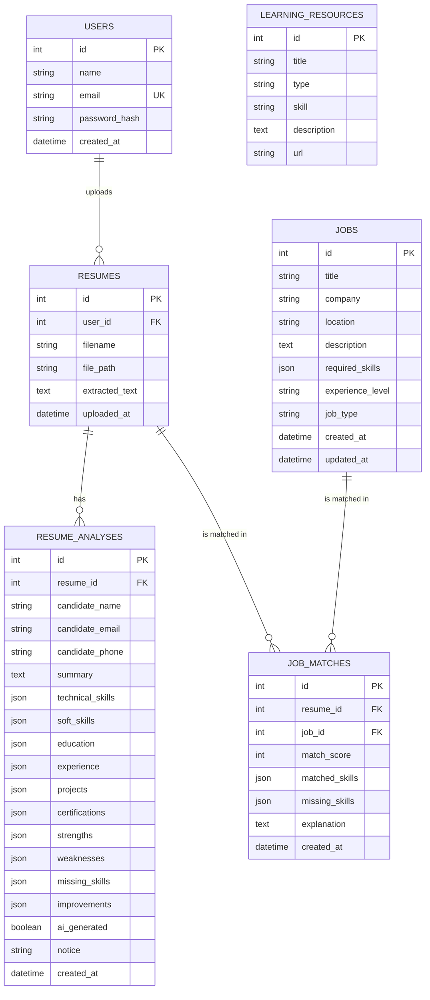

# Entity-Relationship Diagram

## Notes
* One user has many resumes; one resume can be analysed several times (history is kept, the latest is shown).
* `JOB_MATCHES` is the link table between resumes and jobs and stores the deterministic score.
* Deleting a user, resume or job cascades to its dependent rows (`ON DELETE CASCADE` + ORM cascade).
* `LEARNING_RESOURCES` is a reference table (also indexed by the RAG pipeline); it is linked to skills by the
  `skill` name, not by a foreign key, because skills are a vocabulary and not a table in this project.
* List-like fields (skills, strengths ...) use SQLAlchemy's `JSON` type, which SQLite stores as text.
